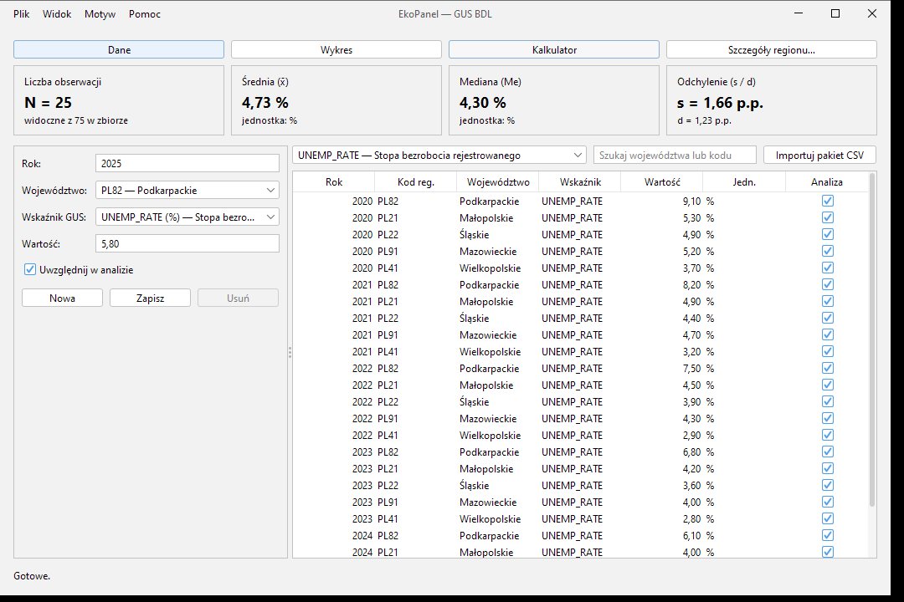
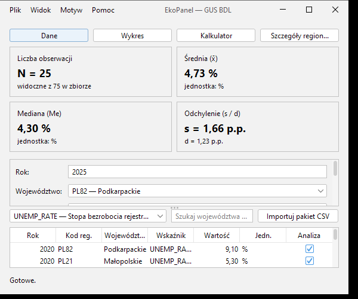
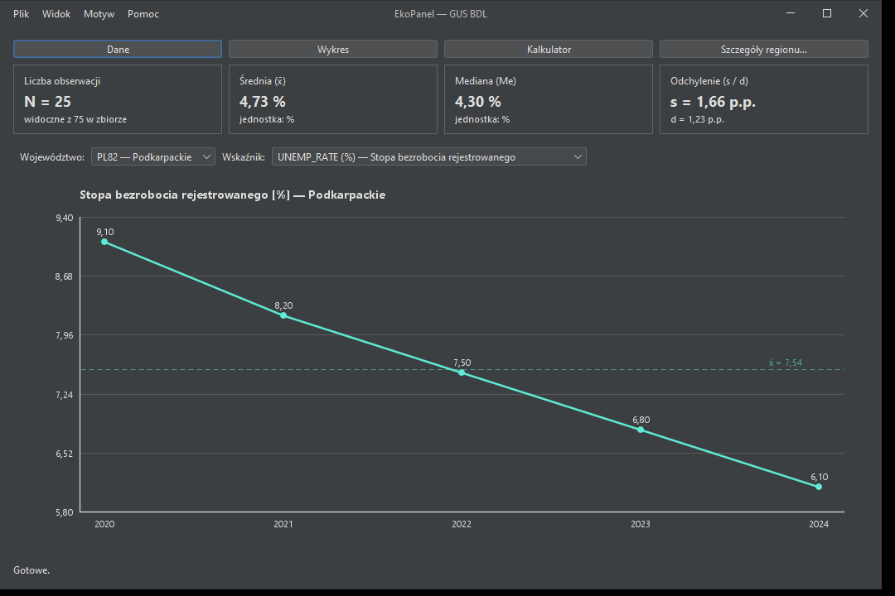
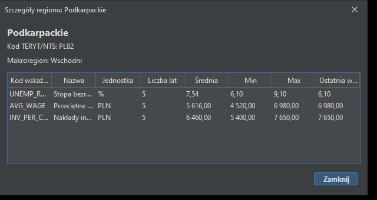

# Lab 1 — EkoPanel GUS BDL (Swing)

Środowisko: JDK 27.0.1 (Oracle), Maven 3.10, FlatLaf 3.7, jSystemThemeDetector 3.9, Windows 10 Pro.

## Weryfikacja obliczeń

| Test | Oczekiwane | Wynik |
|------|------------|-------|
| `StatisticsCheck` (6 przypadków brzegowych) | wszystkie zgodne | OK |
| Import `data/observations.csv` | 75 obserwacji (5 regionów, 3 wskaźniki) | OK |
| Filtr UNEMP_RATE | N = 25, x̄ = 4,73 %, Me = 4,30 %, s = 1,66 p.p., d = 1,23 p.p. | OK |
| Filtr AVG_WAGE | N = 25, x̄ = 6 562,80, Me = 6 490,00, s = 1 298,97, d = 1 046,91 PLN | OK |
| `observations-bledne.csv` | Wiersz 77: Wartość musi być poprawną liczbą dziesiętną. | OK, w tabeli pozostaje 75 |
| `observations-duplikat.csv` | Wiersz 77: duplikat 2020 / PL82 / UNEMP_RATE | OK, w tabeli pozostaje 75 |
| `observations-brak-klucza.csv` | Wiersz 77: Nieznany kod regionu: PL99. | OK, w tabeli pozostaje 75 |
| Kalkulator 4520,00 → 6980,00 | +2460,00; +54,42 %; 154,42 % | OK |
| Kalkulator 9,10 → 6,10 | -3,00; -32,97 %; 67,03 % | OK |

## Macierz 12 prób DPI i motywów

Skalowanie wymuszone przez `-Dsun.java2d.uiScale=<1|1.5|2>`. Rozmiary okna i szerokość obszaru treści są
w pikselach logicznych, więc progi układu (760 px / 680 px) działają tak samo przy każdym DPI.

| # | Skala | Rozmiar okna | Motyw | Szer. treści | JSplitPane | Karty KPI | Uwagi |
|---|-------|--------------|-------|--------------|------------|-----------|-------|
| 1 | 100% | 480 × 360 | Jasny | 464 | VERTICAL (0.45) | 2 × 2 | OK |
| 2 | 100% | 480 × 360 | Ciemny | 464 | VERTICAL (0.45) | 2 × 2 | OK |
| 3 | 100% | 1080 × 720 | Jasny | 1064 | HORIZONTAL (0.32) | 1 × 4 | OK |
| 4 | 100% | 1080 × 720 | Ciemny | 1064 | HORIZONTAL (0.32) | 1 × 4 | OK |
| 5 | 150% | 480 × 360 | Jasny | 470 | VERTICAL (0.45) | 2 × 2 | OK |
| 6 | 150% | 480 × 360 | Ciemny | 470 | VERTICAL (0.45) | 2 × 2 | OK |
| 7 | 150% | 1080 × 720 | Jasny | 1070 | HORIZONTAL (0.32) | 1 × 4 | OK |
| 8 | 150% | 1080 × 720 | Ciemny | 1070 | HORIZONTAL (0.32) | 1 × 4 | OK |
| 9 | 200% | 480 × 360 | Jasny | 472 | VERTICAL (0.45) | 2 × 2 | OK |
| 10 | 200% | 480 × 360 | Ciemny | 472 | VERTICAL (0.45) | 2 × 2 | OK |
| 11 | 200% | 1080 × 720 | Jasny | 1072 | HORIZONTAL (0.32) | 1 × 4 | wysokość ograniczona przez ekran do 550 px logicznych |
| 12 | 200% | 1080 × 720 | Ciemny | 1072 | HORIZONTAL (0.32) | 1 × 4 | j.w. |

W żadnej próbie nie wystąpiły wyjątki. Przy 200% ekran 1920 × 1080 mieści tylko ok. 540 px logicznych wysokości,
dlatego system przycina okno 1080 × 720.

## Zrzuty ekranu

| Widok | Plik |
|-------|------|
| Układ szeroki (HORIZONTAL_SPLIT, KPI 1 × 4), motyw jasny |  |
| Układ wąski (VERTICAL_SPLIT, KPI 2 × 2), motyw jasny |  |
| Wykres serii czasowej, motyw ciemny |  |
| `RegionDetailsDialog`, motyw ciemny |  |
